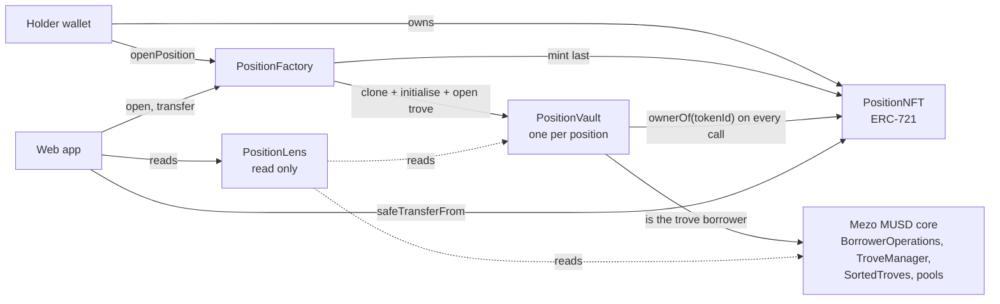

# KEEL

[](https://github.com/Oladayo-Ahmod/keel/actions/workflows/ci.yml)

Tradable MUSD positions on Mezo.

A MUSD trove is bound to one address and cannot be transferred. KEEL puts each trove inside a small vault contract and represents the vault as an ERC-721. Whoever holds the NFT controls the trove, so a position (collateral, debt and its locked interest rate) can be sent, gifted or sold as one object.

**Live app:** _link to be added_ (testnet only)

Status: wave 1 of the Mezo Buildathon. The contracts are deployed on Mezo testnet, and the web app has a positions view, an open-position flow and an NFT transfer flow. Wave 2 (marketplace and guardian) is not started. Read [docs/KNOWN_LIMITATIONS.md](docs/KNOWN_LIMITATIONS.md) first: this code is not audited.

## How it works



The same picture in text:

```
holder --ownerOf--> PositionNFT <--mint (last)-- PositionFactory
                        ^                              | clone + open
                        | ownerOf on every call        v
                    PositionVault  ------------>  Mezo MUSD core
PositionLens (views) ----reads---------------->  vault, TroveManager, SortedTroves, PriceFeed
```

- `PositionFactory` opens a position: clones a vault, opens the trove, mints the NFT. No owner, no setters, no upgrade path.
- `PositionVault` owns the trove. Authority is `nft.ownerOf(tokenId)` at call time and nothing else, so a transfer resets every permission without a single write. Funds only go to the caller. It wraps open, add and withdraw collateral, borrow, repay (with permit), adjust, refinance, close (with permit) and claim surplus.
- `PositionNFT` is an enumerable ERC-721 that also keeps a transfer epoch per token.
- `PositionLens` is a read-only view: ratio, equity, locked against market rate, rate spread, claimable surplus and a redemption buffer.

The refinance wrapper only allows a strictly lower rate and enforces a fee cap, because Mezo's own `refinance` would move a trove to a higher rate. The redemption buffer is a lower bound unless the walk completes, and the Lens says which.

Wave 2 adds a state-committed marketplace and a policy-bounded guardian. See [docs/ARCHITECTURE.md](docs/ARCHITECTURE.md).

## Deployed

Mezo testnet, chain id 31611.

| Contract | Address | Sourcify |
|---|---|---|
| PositionFactory | `0xCDf7E1a6Be19EcE762477Cf89c786B9216307405` | [exact match](https://repo.sourcify.dev/31611/0xCDf7E1a6Be19EcE762477Cf89c786B9216307405) |
| PositionNFT | `0xEF892989eAa3acB203803aA8b4946a40815F948C` | [exact match](https://repo.sourcify.dev/31611/0xEF892989eAa3acB203803aA8b4946a40815F948C) |
| PositionVault implementation | `0x7A546Ba684D8A7bdcA408F4f2e65e4E3F112208E` | [exact match](https://repo.sourcify.dev/31611/0x7A546Ba684D8A7bdcA408F4f2e65e4E3F112208E) |
| PositionLens | `0x5e499cA8643cB4aB56a2E0A6E34De3DFb8DfFBD9` | [exact match](https://repo.sourcify.dev/31611/0x5e499cA8643cB4aB56a2E0A6E34De3DFb8DfFBD9) |

Deploy transactions, demo positions and the live transfer check are in [docs/DEPLOYMENTS.md](docs/DEPLOYMENTS.md).

Blockscout would not accept the same inputs that Sourcify accepted. To check a deployment without trusting any explorer, [script/check_bytecode.sh](script/check_bytecode.sh) compares the creation input of the deploy transactions with what a checkout compiles to:

```
script/check_bytecode.sh <factory deploy tx> <lens deploy tx> <nft address>
```

The exact command with the real hashes is in DEPLOYMENTS.md.

## Run it

### Contracts

Needs [Foundry](https://getfoundry.sh). Submodules hold the pinned MUSD source and OpenZeppelin.

```
git clone --recurse-submodules https://github.com/Oladayo-Ahmod/keel
cd keel
forge test
```

Tests deploy the real MUSD contracts (pinned at `aa25fd6`) locally and replace only the oracle. A deeper invariant run: `FOUNDRY_PROFILE=deep forge test --match-contract Invariants`. Mezo runs the `london` EVM, so `foundry.toml` pins `evm_version = "london"` and solc 0.8.24.

### Web app

`web/` is a Next.js 14 app (React 18, which Mezo Passport requires) with wagmi, RainbowKit through Mezo Passport, and anime.js. Every address comes from `web/src/config/deployment.json`.

```
cd web
npm install --legacy-peer-deps   # Passport's own dependencies declare old React peers
cp .env.example .env.local       # set NEXT_PUBLIC_WALLETCONNECT_PROJECT_ID
npm run dev                      # http://localhost:3000
npm test
```

- **Positions view:** ratio gauge, locked against market rate, redemption buffer on demand. Any position can be looked up by NFT id with no wallet (`/?id=1`).
- **Open a position:** amounts and a target ratio, a review step, then sorted-list hints are looked up at the confirm step, the call is simulated, and only then does the wallet prompt appear.
- **Transfer a position:** shows ratio and equity first, needs a typed word for an underwater or low-ratio position, asks for the receiver, requires the last four characters of the address, simulates `safeTransferFrom`, then sends it.
- **Stale node guard:** the public RPC can serve reads from nodes far behind the chain. Every read is paired with the head block of the node that answered it and retried if that node is behind. Data that stays stale is flagged, never shown as healthy, and sending is blocked.
- Pending, success and failure states link the transaction hash to the explorer. Motion respects `prefers-reduced-motion`.

`web/scripts/demo.ts` drives the same contracts from a terminal (status, open, close, transfer) with the key in `ETH_PRIVATE_KEY`. To test the wallet flows by hand, follow [docs/MANUAL_TEST.md](docs/MANUAL_TEST.md).

## Tests

| Suite | Count | What |
|---|---|---|
| Foundry, `forge test` | 90 | unit, fuzz and 7 invariants on a local deployment of the real MUSD contracts; hostile-holder reentrancy tests; deploy script checks |
| Web, `npm test` in `web/` | 42 | formatting, risk levels, hint computation, open plan checks, transfer checks, error mapping, stale node detection |

Line coverage of the contracts is 99%, branch coverage about 89%. The invariant suite also ran 256 runs of depth 200 and passed, and three deliberately broken vault variants were each caught. Details, and what is not covered, are in [docs/TEST_PLAN.md](docs/TEST_PLAN.md).

## Documents

| File | Contents |
|---|---|
| [docs/VERIFICATION.md](docs/VERIFICATION.md) | What the MUSD contracts actually do, with file and line references, and live matsnet measurements |
| [docs/ARCHITECTURE.md](docs/ARCHITECTURE.md) | Components, rules and wave 2 hooks |
| [docs/THREAT_MODEL.md](docs/THREAT_MODEL.md) | Threats T1 to T22, mitigations and tests |
| [docs/DECISIONS.md](docs/DECISIONS.md) | Design decisions and reasons |
| [docs/KNOWN_LIMITATIONS.md](docs/KNOWN_LIMITATIONS.md) | What KEEL does not do or cannot control |
| [docs/TEST_PLAN.md](docs/TEST_PLAN.md) | Test layers, coverage, open items |
| [docs/DEPLOYMENTS.md](docs/DEPLOYMENTS.md) | Addresses, tx hashes, verification, runbook, live transfer check |
| [docs/MANUAL_TEST.md](docs/MANUAL_TEST.md) | Checklist for testing the wallet flows in a browser |

## License

GPL-3.0-or-later, see [LICENSE](LICENSE). The vendored MUSD contracts in `lib/musd` are GPL-3.0 and the test suite compiles and deploys them, so the repository uses the same license rather than argue about the boundary. `@mezo-org/passport` in the web app is GPL-3.0-only, which is also compatible. OpenZeppelin is MIT and compatible.
