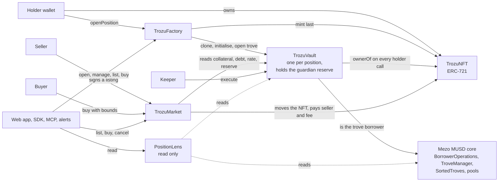
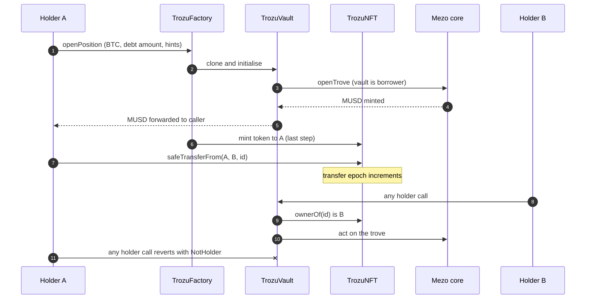
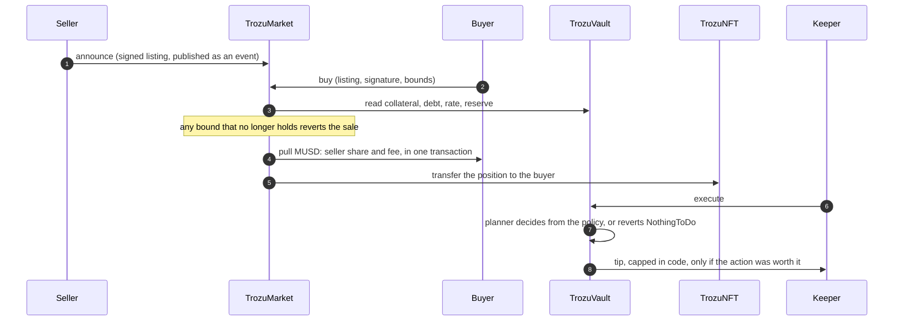

<div align="center">

# Trozu

**Tradable, transferable MUSD positions on Mezo, with a guardian that defends them against redemption.**

Put a trove inside a vault and represent the vault as an ERC-721, so collateral, debt and locked interest rate move as one object. Sell it on a marketplace where the buyer's bounds are checked at settlement, or leave a bounded guardian watching it.

*Formerly KEEL. The original contracts, the repository URL and the app URL still carry the old name; the original NFT is named "KEEL Position" on chain.*

[](https://github.com/Oladayo-Ahmod/keel/actions/workflows/ci.yml)
[](LICENSE)


[Live app](https://keel-two-roan.vercel.app/) · [Proof](https://keel-two-roan.vercel.app/proof) · [Break it](https://keel-two-roan.vercel.app/break-it) · [Stats](https://keel-two-roan.vercel.app/stats) · [Architecture](docs/ARCHITECTURE.md) · [Threat model](docs/THREAT_MODEL.md) · [Deployments](docs/DEPLOYMENTS.md) · [Viability](docs/VIABILITY.md) · [Packages](packages/) · [Integrations](docs/INTEGRATIONS.md)

</div>

> **Status:** deployed on Mezo testnet only. The contracts have not been independently audited; the review in [docs/REVIEW.md](docs/REVIEW.md) is AI-assisted, not an audit. All activity on testnet so far was run by the team. Nothing is deployed on Mezo mainnet, and Trozu earns no revenue. Read [Known limitations](docs/KNOWN_LIMITATIONS.md) before using this code with real funds.

---

## Table of contents

- [Overview](#overview)
- [What is in the repository](#what-is-in-the-repository)
- [Why Trozu](#why-trozu)
- [Key properties](#key-properties)
- [Architecture](#architecture)
- [Position lifecycle](#position-lifecycle)
- [Security model](#security-model)
- [Deployments](#deployments)
- [Getting started](#getting-started)
- [Web app](#web-app)
- [Packages](#packages)
- [Testing](#testing)
- [Repository layout](#repository-layout)
- [Documentation](#documentation)
- [Roadmap](#roadmap)
- [License](#license)

## Overview

MUSD is Mezo's Bitcoin-backed stablecoin. You mint it by opening a **trove**: BTC collateral against MUSD debt, at an interest rate fixed when the trove is opened.

A trove is keyed by the address that opened it and cannot be moved. To hand a position to a team wallet, a client or a buyer you have to repay the debt, close the trove and open a new one, which loses the locked rate and pays the opening fee again. And redemptions take collateral from the lowest-ratio troves first, with no standing defense for the borrower.

Trozu opens each trove from a small vault contract and represents the vault as an ERC-721. Whoever holds the token controls the trove, so a position can be sent, gifted or sold. On top of that sit a marketplace and a guardian.

**Read this before the pitch.** The mainnet MUSD book is **3 troves** (71,696 MUSD of debt, 17.47 BTC). The global interest rate has been **1.00% since block 0**, so a locked rate has no price today. Trozu's **revenue today is zero**. The market is large in flow (1,204 redemptions, 5.9M MUSD redeemed) and small in stock. The numbers, their limits and what follows from them are in [docs/VIABILITY.md](docs/VIABILITY.md) and [docs/MARKET_DATA.md](docs/MARKET_DATA.md).

## What is in the repository

| Part | What it does | Where |
|---|---|---|
| **Position NFT** | A trove, its collateral, its debt and its locked rate as one ERC-721. A transfer hands everything over in one transaction and locks out the previous holder. | `src/v2/TrozuVault.sol`, `TrozuNFT.sol`, `TrozuFactory.sol` |
| **Marketplace** | The holder signs an EIP-712 listing, at a fixed price or a falling (Dutch) price, and publishes it as an event. A buyer commits to bounds on collateral, debt, rate, reserve and price, which are checked in the same transaction that pays the seller and moves the NFT. A 25 bps fee (cap 100 bps) goes to a recipient fixed at deployment. | `src/v2/TrozuMarket.sol` |
| **Guardian** | The holder funds a reserve of BTC or MUSD inside the vault and sets a policy: a ratio floor and target, caps per action and per period, a keeper tip, and optionally a redemption-buffer threshold. Anyone can trigger an action, and it only runs if the vault's own planner says the policy calls for it. It never refinances. | `TrozuVault.sol` (`setPolicy`, `execute`, `preview`) |
| **Keeper** | A script, run on a schedule by GitHub Actions, that finds vaults with a policy, asks each one's planner, and sends `execute` where it would act. Without its key secret the workflow only does a dry run. | `keeper/`, `.github/workflows/keeper.yml` |
| **Web app** | Open, manage, transfer, sell and buy positions, set a guardian policy, a price estimate in the sell flow, and a what-if simulator on each position. | `web/` |
| **Proof page** | Each claim about Trozu, how it was checked and a link to the evidence. A claim with no evidence is marked open. | `/proof`, `web/src/content/proof.json`, [docs/PROOF.md](docs/PROOF.md) |
| **Break-it page** | Attacks that were tried and what happened, including the ones that worked and were fixed. | `/break-it`, [docs/REVIEW.md](docs/REVIEW.md) |
| **Stats page** | Counts read from the contracts' event logs, with what each count is built from. All activity so far is the team's own test traffic, and the page says so. | `/stats` |
| **SDK** | `@trozu/sdk` reads positions, listings and guardians and builds unsigned transactions. It never signs. | `packages/sdk` |
| **MCP server** | `@trozu/mcp` gives Claude Desktop and Claude Code read-only tools over the SDK. | `packages/mcp` |
| **Alerts** | `@trozu/alerts` posts to a webhook when a guarded position nears its floor or the keeper acts. No keys. | `packages/alerts` |

## Why Trozu

| Problem with a plain trove | What Trozu changes |
|---|---|
| The position is tied to one address forever. | The position is an NFT. Transfer the token and the whole position moves. |
| Moving a position means closing it, repaying all debt and reopening at the current rate. | The collateral, debt and locked rate stay exactly as they were. |
| Selling a position means trusting the seller not to change it first. | The buyer signs bounds on collateral, debt, rate and reserve, and the sale fails if any of them no longer holds. |
| Redemption risk is invisible, and a borrower near the bottom of the list can only top up by hand. | A redemption buffer says how much MUSD must be redeemed before a position is reached, and the guardian can add collateral inside bounds the holder set. |
| Handing over a position is an all-or-nothing trust exercise. | Authority is derived from the NFT owner at call time, so a transfer resets every permission, listing and policy without a storage write. |

## Key properties

- **One source of authority.** The vault checks `nft.ownerOf(tokenId)` on every holder call and nothing else. There is no stored owner to go stale, no admin and no upgrade path in Trozu's own contracts.
- **Funds only go to the caller.** Every payout from a vault is sent to `msg.sender`, who must be the holder.
- **Instant, complete hand-over.** A transfer locks out the previous holder, and anyone they approved, in the same transaction. A per-token transfer epoch invalidates listings and guardian policies made under the previous holder.
- **Bounded settlement.** A listing is only valid for the epoch it was signed in, and a buyer's bounds are checked at settlement, so changing the position after listing only makes the sale fail.
- **A bounded guardian.** It acts only inside the holder's caps, only when a complete planner says so, and pays a tip capped in code at 0.0001 BTC. An action must move at least ten times its tip in value, or it pays none.
- **Safe refinancing.** Mezo's own `refinance` moves a trove to the current global rate whether that is lower or higher. The vault wrapper only allows a strictly lower rate and enforces a fee cap.
- **Reentrancy-aware.** Mezo pays BTC out with a low-level call and its own source says re-entry is fine. Every state-changing vault function is `nonReentrant`, the NFT is minted last, and a hostile contract holder is part of the test suite.
- **Honest risk data.** The redemption buffer is a lower bound unless the walk of the sorted list completes, and the lens says which one it is returning. A guardian never acts on a buffer it could not prove.

## Architecture



| Contract | Role |
|---|---|
| `TrozuFactory` | Clones a vault (EIP-1167), opens the trove from it, then mints the NFT as the last step. Creates the NFT, the lens and the vault implementation. No owner and no setters. |
| `TrozuVault` | Is the borrower of the trove. Wraps open, add and withdraw collateral, borrow, repay (with permit), refinance, close (with permit), claim surplus and sweep. Holds the guardian reserve, the policy and `execute`. Authority is the current NFT owner. |
| `TrozuNFT` | Enumerable ERC-721 ("Trozu Position", `TROZU`) that also tracks a transfer epoch per token. |
| `TrozuMarket` | Signed listings, fixed price or Dutch, with a buyer's bounds checked at settlement. Immutable fee (25 bps, capped at 100) and fee recipient. Holds nothing between calls. |
| `PositionLens` | Read-only view of ratio, equity, locked versus market rate, annual rate spread, claimable surplus and the redemption buffer, including the bounded verdict the guardian uses. Uses `getEntireDebtAndColl`, so pending redistribution and accrued interest are included. |

The original contracts (`PositionFactory`, `PositionVault`, `PositionNFT`, `PositionLens`) are still deployed on testnet, unchanged. The Trozu contracts keep the same vault interface, so the app and the SDK work with both, but only Trozu positions can be sold or guarded. Each contract, the guardian's planner, the keeper and the packages are described in detail in [docs/ARCHITECTURE.md](docs/ARCHITECTURE.md), and the reasons for each choice are numbered in [docs/DECISIONS.md](docs/DECISIONS.md).

## Position lifecycle



A sale and a guardian action:



## Security model

The design is built around invariants, each covered by a test:

1. Only the current `ownerOf(tokenId)` can move funds out of a vault or change its trove.
2. A vault holds no funds between calls, apart from the guardian reserve and forced sends, which the holder can sweep.
3. After a transfer, the previous holder and anyone they approved have no power over the vault, and listings and policies made under them stop applying.
4. Every external payout from a vault goes to the caller, who is the holder.
5. The guardian stays inside the policy: caps per action and per period, the tip cap, and the 110% line.
6. The market is atomic and holds nothing between calls.

What the repository includes to back that up:

- A [threat model](docs/THREAT_MODEL.md) of 22 threats (T1 to T22, seven of them specific to the marketplace and guardian) covering reentrancy through native BTC callbacks, factory mint callbacks, clone initialisation, approval leakage across transfers, refinance edge cases, Recovery Mode and last-trove liveness, forced sends, permit front-running, redemption risk, and the upgradeability of Mezo's own core contracts.
- Tests that deploy the **real MUSD contracts** (pinned at commit `aa25fd6`) and replace only the oracle, so behaviour cannot drift from a hand-written mock.
- Invariant suites with state-machine handlers that interleave holder actions, transfers, listings, sales, keeper calls, strangers and previous holders, redemptions, liquidations, price moves, rate changes and time.
- An AI-assisted review ([docs/REVIEW.md](docs/REVIEW.md)): three findings with working exploits (two Medium, one Low), all fixed with regression tests, plus two more found later by the project's own tests (a what-if planner that disagreed with the contract in 81 of 503 states, and a buffer check that used the wrong lens). **It is not an independent audit.**
- A [break-it page](https://keel-two-roan.vercel.app/break-it) that lists those attacks and the refusals recorded on testnet.
- [Live protocol measurements](docs/VERIFICATION.md) (gas of the redemption buffer walk, sorted-list hint behaviour, proxy layout) and [gas measurements](docs/gas-measurements.json) of every action, taken against Mezo testnet.

**Trust assumptions you inherit.** Mezo's core contracts are upgradeable proxies. A change to them can alter fees, remove a getter Trozu reads, or block a function. Trozu holds no admin power over Mezo and cannot prevent this. Positions are therefore not trustless with respect to Mezo governance. This is stated in [Known limitations](docs/KNOWN_LIMITATIONS.md).

**Not audited.** The code has not had an independent security review.

## Deployments

Mezo testnet (chain id `31611`, RPC `https://rpc.test.mezo.org`, explorer `https://explorer.test.mezo.org`). Checked against Sourcify's API on 2026-11-08.

**Trozu contracts**, deployed 2026-11-06:

| Contract | Address | Sourcify |
|---|---|---|
| TrozuFactory | `0x70791379537cB14981AA7114678663164141eC31` | [exact match](https://repo.sourcify.dev/31611/0x70791379537cB14981AA7114678663164141eC31) |
| TrozuNFT | `0xd53f649e4df31351De8935De9cA7110888F055b8` | [exact match](https://repo.sourcify.dev/31611/0xd53f649e4df31351De8935De9cA7110888F055b8) |
| PositionLens | `0xCCF8c5aFe7473eC41F64906071e1bE497872004C` | [exact match](https://repo.sourcify.dev/31611/0xCCF8c5aFe7473eC41F64906071e1bE497872004C) |
| TrozuVault (implementation) | `0x6ef4395325828083672FFe836d6Bc80Bf22cACFE` | [exact match](https://repo.sourcify.dev/31611/0x6ef4395325828083672FFe836d6Bc80Bf22cACFE) |
| TrozuMarket | `0xEae6fEa26B178eF32829F36e5219363bB30D93DB` | [exact match](https://repo.sourcify.dev/31611/0xEae6fEa26B178eF32829F36e5219363bB30D93DB) |

All five are `exact_match` on Sourcify (checked 2026-11-08; the history of how is in [docs/DEPLOYMENTS.md](docs/DEPLOYMENTS.md)). Fee recipient is the deployer address, fixed at deployment; fee 25 bps.

**Original contracts**, unchanged and still deployed:

| Contract | Address | Sourcify |
|---|---|---|
| PositionFactory | `0xCDf7E1a6Be19EcE762477Cf89c786B9216307405` | [exact match](https://repo.sourcify.dev/31611/0xCDf7E1a6Be19EcE762477Cf89c786B9216307405) |
| PositionNFT | `0xEF892989eAa3acB203803aA8b4946a40815F948C` | [exact match](https://repo.sourcify.dev/31611/0xEF892989eAa3acB203803aA8b4946a40815F948C) |
| PositionVault (implementation) | `0x7A546Ba684D8A7bdcA408F4f2e65e4E3F112208E` | [exact match](https://repo.sourcify.dev/31611/0x7A546Ba684D8A7bdcA408F4f2e65e4E3F112208E) |
| PositionLens | `0x5e499cA8643cB4aB56a2E0A6E34De3DFb8DfFBD9` | [exact match](https://repo.sourcify.dev/31611/0x5e499cA8643cB4aB56a2E0A6E34De3DFb8DfFBD9) |

Deploy transactions, the live proof run, the round trip through the app and the runbook are in [docs/DEPLOYMENTS.md](docs/DEPLOYMENTS.md), [docs/PROOF.md](docs/PROOF.md) and [docs/ROUNDTRIP.md](docs/ROUNDTRIP.md). `npm run check:deployment` in `web/` fails if any address in `web/src/config/deployment.v2.json` has no code on chain.

### Verify a deployment without trusting an explorer

Blockscout would not accept inputs that Sourcify accepted, so the repository ships a bytecode check. It compares the creation input of the deploy transactions with what a clean checkout compiles to:

```bash
script/check_bytecode.sh <factory deploy tx> <lens deploy tx> <nft address>
```

The exact command with the real transaction hashes is in [docs/DEPLOYMENTS.md](docs/DEPLOYMENTS.md). `script/sourcify_metadata.mjs` submits the build's own metadata to Sourcify for the Trozu contracts (`script/verify_v2.sh` is the older `forge verify-contract` route, which left them at `match`).

## Getting started

### Use the hosted app

1. Open **https://keel-two-roan.vercel.app/**.
2. Add Mezo testnet to your wallet: chain id `31611`, RPC `https://rpc.test.mezo.org`.
3. Get testnet BTC from the [faucet](https://faucet.test.mezo.org/). BTC is both the gas token and the collateral.
4. Open a position. The minimum is 1,800 MUSD of net debt. At a 150% ratio that is about 0.037 BTC when BTC is around 82,000 USD.

Test MUSD has no faucet. It comes from opening a position.

### Build from source

Requirements: [Foundry](https://getfoundry.sh) and git submodules (the pinned MUSD source and OpenZeppelin). The web app and the packages are built with Node 22.

```bash
git clone --recurse-submodules https://github.com/Oladayo-Ahmod/keel
cd keel
forge test
```

Mezo runs the `london` EVM, so `foundry.toml` pins `evm_version = "london"` and solc `0.8.24`. That means no `PUSH0` and no transient storage.

### Run the keeper

`keeper/` is a TypeScript script. It reads the chain, asks each guarded vault's planner whether `execute()` would act, and sends it where it would. It reads its key from the `KEEPER_PRIVATE_KEY` environment variable and refuses to send without one; `--dry-run` reads and estimates only. The GitHub workflow `.github/workflows/keeper.yml` runs it every 15 minutes with the key in a repository secret, and falls back to a dry run when the secret is missing.

### Deploy your own copy

`script/DeployV2.s.sol` (and `script/Deploy.s.sol` for the original contracts) reads the deployer key from the `DEPLOYER_PRIVATE_KEY` environment variable. Never put a key in a file inside the repository. See `.env.example` and the runbook in [docs/DEPLOYMENTS.md](docs/DEPLOYMENTS.md).

## Web app

`web/` is a Next.js 14 app (React 18, which Mezo Passport requires) using wagmi, RainbowKit through Mezo Passport, and anime.js. Every contract address comes from `web/src/config/deployment.json` and `deployment.v2.json`.

```bash
cd web
npm install --legacy-peer-deps    # Passport's own dependencies declare older React peers
cp .env.example .env.local        # set NEXT_PUBLIC_WALLETCONNECT_PROJECT_ID
npm run dev                       # http://localhost:3000
npm test
```

**Deploying it.** A production build needs `NEXT_PUBLIC_SITE_URL` (the public address, used for share images), or Vercel's `VERCEL_PROJECT_PRODUCTION_URL`; it stops on a missing or local one. `NEXT_PUBLIC_WAVE2=1` turns on the market and guardian screens. See [docs/web.md](docs/web.md).

**Positions.** An animated ratio gauge with marks at 110% (liquidation) and 150%, locked versus market rate with the annual spread, equity, claimable surplus, and the redemption buffer on demand. Any position can be looked up by NFT id without a wallet, and each has a public page and a share image at `/position/<1 or 2>/<id>`.

**Open, manage, transfer.** Amounts and target-ratio buttons, then a review step. Sorted-list hints are computed at the confirm step, every call is simulated, and only then does the wallet prompt appear. The app blocks under 120% and warns under 150%. Add and withdraw collateral, borrow, repay, refinance, close, claim surplus and sweep go through one flow. Transfer shows ratio and equity first and requires the receiver's last four characters.

**Market.** Browse listings rebuilt from the market's event log, buy with bounds taken from what was on screen, list your own position at a fixed or falling price with a price estimate that shows its inputs, and cancel. A listing from one of the team's wallets is marked as a demo listing.

**Guardian.** Set a policy (validated against every revert the contract has), fund and withdraw the reserve, and read what keepers have done. A what-if simulator on each position moves the BTC price and redemption pressure and shows the ratio, the buffer and what the guardian would do. It is a model, not a prediction.

**Resilient reads.** The public RPC can serve reads from nodes far behind the chain. Every read is paired with the head block of the node that answered it and retried if that node is behind. Data that stays stale is flagged instead of shown as healthy, and sending is blocked.

Pending, success and failure states link the transaction hash to the explorer. Motion respects `prefers-reduced-motion`.

`web/scripts/demo.ts` drives the original contracts from a terminal, reading the key from `ETH_PRIVATE_KEY` so it never appears on a command line. A manual wallet checklist is in [docs/MANUAL_TEST.md](docs/MANUAL_TEST.md).

## Packages

[`packages/`](packages/) holds three TypeScript packages that sit next to the app. Build them from this repository with `npm ci && npm run build` in `packages/`.

- [`@trozu/sdk`](packages/sdk/README.md) reads positions, listings and guardians and builds unsigned transactions with explicit gas limits. It never signs. Its gas table matches the app's, and a test fails if they differ.
- [`@trozu/mcp`](packages/mcp/README.md) exposes the SDK to Claude Desktop and Claude Code as read-only tools. It cannot sign or send, and a test fails if its source could.
- [`@trozu/alerts`](packages/alerts/README.md) posts to a webhook when a guarded position nears its floor or the keeper acts. A GitHub workflow (`.github/workflows/trozu-alerts.yml`) runs it only when its webhook secret is set.

Start with [INTEGRATIONS.md](docs/INTEGRATIONS.md), which also lists what was and was not tested.

## Testing

| Suite | Count | Scope |
|---|---|---|
| Foundry (`forge test`) | 260 | Unit, fuzz and invariants on a local deployment of the real MUSD contracts, the market and guardian, the original vault tests re-run against the Trozu vault, fork tests on mainnet state, and the golden planner vectors |
| Web (`npm test` in `web/`) | 300 | Gas limits, market and guardian maths, permits, error mapping, stale node detection, stats, share cards, and the what-if planner replayed against contract vectors |
| Keeper (`npm test` in `keeper/`) | 24 | The keeper's discovery, retry and send logic on a mock chain |
| SDK (`@trozu/sdk`) | 90 (+39 skipped) | Maths, builders, reads on a mock chain, gas table drift; the skipped ones are read-only matsnet checks, run on demand |
| MCP (`@trozu/mcp`) | 78 | Tools, hostile inputs, no signing or sending, stdio handshake |
| Alerts (`@trozu/alerts`) | 45 (+1 skipped) | Rules, state, webhook posting on a stubbed fetch; the skipped one is an opt-in live webhook test |

Line coverage of the original contracts is 99% and branch coverage is about 89%, measured with `--ir-minimum` before the Trozu contracts were added, so treat the branch figure as approximate and the figure as not covering them. A deeper invariant profile (256 runs, depth 200) also passes:

```bash
FOUNDRY_PROFILE=deep forge test --match-contract Invariants
```

The counts are separate suites and are not added together. What is not covered, and why, is listed in [docs/TEST_PLAN.md](docs/TEST_PLAN.md).

## Repository layout

```
src/            Original contracts (factory, vault, NFT, lens) and src/v2: the Trozu factory, vault, NFT and market
script/         Deploy scripts, bytecode check, market data and live measurement tools
test/           Unit, fuzz and invariant tests, with their helpers and handlers
lib/            Pinned MUSD source and OpenZeppelin (git submodules)
web/            Next.js app, deployment config, test-wallet checks, demo script
keeper/         Guardian keeper and the live proof run
packages/       TypeScript SDK (@trozu/sdk), MCP server (@trozu/mcp) and webhook alerts (@trozu/alerts)
docs/           Threat model, decisions, viability, review, proof, deployments, integrations
.github/        CI, keeper and alerts workflows
```

## Documentation

| Document | Contents |
|---|---|
| [VIABILITY.md](docs/VIABILITY.md) | What the market data supports, the revenue model, what happens if rates stay flat, who uses it first, and a section for real user feedback |
| [MARKET_DATA.md](docs/MARKET_DATA.md) | The Mezo mainnet snapshot behind it, with the script and its limits |
| [ARCHITECTURE.md](docs/ARCHITECTURE.md) | Every contract (the original ones and the Trozu vault, market and guardian), the keeper, the app and the packages: what each does, its rules and its limits |
| [THREAT_MODEL.md](docs/THREAT_MODEL.md) | Threats, mitigations and the tests that cover them |
| [REVIEW.md](docs/REVIEW.md) | The AI-assisted review, what it found, what was fixed, and what it does not cover |
| [DECISIONS.md](docs/DECISIONS.md) | Design decisions and reasons |
| [VERIFICATION.md](docs/VERIFICATION.md) | What the MUSD contracts do, with file and line references, plus live measurements |
| [PROOF.md](docs/PROOF.md) | The live proof run on testnet, transaction by transaction |
| [ROUNDTRIP.md](docs/ROUNDTRIP.md) | Every wallet action run once through the app, with gas and screenshots |
| [INTEGRATIONS.md](docs/INTEGRATIONS.md) | Using Trozu from code: the SDK, the MCP server for Claude Desktop and Claude Code, and webhook alerts, with what was and was not tested |
| [web.md](docs/web.md) | What the app does, how it was checked, and what is not verified |
| [KNOWN_LIMITATIONS.md](docs/KNOWN_LIMITATIONS.md) | What Trozu does not do or cannot control |
| [TEST_PLAN.md](docs/TEST_PLAN.md) | Test layers, counts, coverage and open items |
| [DEPLOYMENTS.md](docs/DEPLOYMENTS.md) | Addresses, transactions, verification and runbook |
| [MANUAL_TEST.md](docs/MANUAL_TEST.md) | Checklist for testing the wallet flows by hand |

## Roadmap

- **A real user.** Everything on testnet so far was run by the team. The next step that matters is someone else setting a guardian policy or buying a position, and writing down what they say ([docs/VIABILITY.md](docs/VIABILITY.md) has the section for it).
- **Rate-dependent features.** Locked-rate pricing and rate-drop refinancing only matter if Mezo governance moves the global rate, which has not happened. The app shows no premium rather than inventing one.
- **Independent audit** before any mainnet deployment. There is no mainnet deployment.

## License

GPL-3.0-or-later. See [LICENSE](LICENSE).
