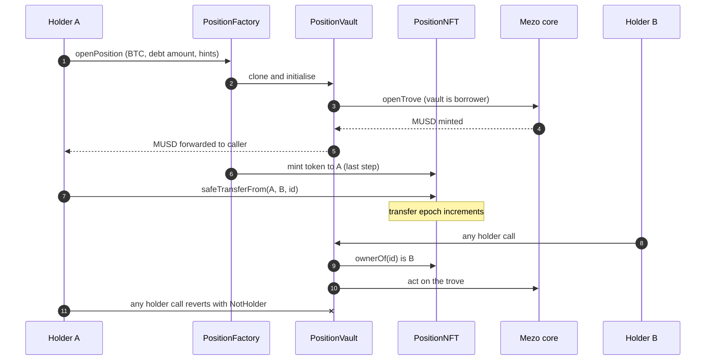

<div align="center">

# KEEL

**Tradable, transferable MUSD positions on Mezo.**

Put a trove inside a vault, represent the vault as an ERC-721, and move collateral, debt and locked interest rate as a single object.

[](https://github.com/Oladayo-Ahmod/keel/actions/workflows/ci.yml)
[](LICENSE)


[Live app](https://keel-two-roan.vercel.app/) · [Architecture](docs/ARCHITECTURE.md) · [Threat model](docs/THREAT_MODEL.md) · [Deployments](docs/DEPLOYMENTS.md)

</div>

> **Status:** deployed on Mezo testnet. The contracts have not been independently audited. Read [Known limitations](docs/KNOWN_LIMITATIONS.md) before using this code with real funds.

---

## Table of contents

- [Overview](#overview)
- [Why KEEL](#why-keel)
- [Key properties](#key-properties)
- [Architecture](#architecture)
- [Position lifecycle](#position-lifecycle)
- [Security model](#security-model)
- [Deployments](#deployments)
- [Getting started](#getting-started)
- [Web app](#web-app)
- [Testing](#testing)
- [Repository layout](#repository-layout)
- [Documentation](#documentation)
- [Roadmap](#roadmap)
- [License](#license)

## Overview

MUSD is Mezo's Bitcoin-backed stablecoin. You mint it by opening a **trove**: BTC collateral against MUSD debt, at an interest rate fixed when the trove is opened.

A trove is keyed by the address that opened it and cannot be moved. If you want to hand a position to a team wallet, a client or a buyer, you have to repay the debt, close the trove and open a new one, which loses the locked rate and pays the opening fee again.

KEEL removes that limit. Each trove is opened by a small vault contract, and the vault is represented by an ERC-721 token. Whoever holds the token controls the trove. A position, meaning its collateral, debt and locked interest rate, becomes one object that can be sent, gifted or sold.

## Why KEEL

| Problem with a plain trove | What KEEL changes |
|---|---|
| The position is tied to one address forever. | The position is an NFT. Transfer the token and the whole position moves. |
| Moving a position means closing it, repaying all debt and reopening at the current rate. | The collateral, debt and locked rate stay exactly as they were. |
| A trove opened at a low rate carries value that cannot travel to another owner. | The locked rate is readable on chain next to the market rate, so the spread has a number, and it moves with the position. |
| Redemption risk is invisible. Redeemers take collateral from the lowest-ratio troves first. | A redemption buffer estimates how much MUSD must be redeemed before a position is reached. |
| Handing over a position is an all-or-nothing trust exercise. | Authority is derived from the NFT owner at call time, so a transfer resets every permission without a single storage write. |

## Key properties

- **One source of authority.** The vault checks `nft.ownerOf(tokenId)` on every holder call and nothing else. There is no stored owner to go stale, no admin and no upgrade path in KEEL's own contracts.
- **Funds only go to the caller.** Every payout from a vault is sent to `msg.sender`, who must be the holder.
- **Instant, complete hand-over.** A transfer locks out the previous holder, and anyone they approved, in the same transaction. A per-token transfer epoch lets future components invalidate stale state without help from the vault.
- **Safe refinancing.** Mezo's own `refinance` moves a trove to the current global rate whether that is lower or higher. The vault wrapper only allows a strictly lower rate and enforces a fee cap.
- **Reentrancy-aware.** Mezo pays BTC out with a low-level call and its own source says re-entry is fine. Every state-changing vault function is `nonReentrant`, the NFT is minted last, and a hostile contract holder is part of the test suite.
- **Honest risk data.** The redemption buffer is a lower bound unless the walk of the sorted list completes, and the read-only Lens says which one it is returning.

## Architecture


| Contract | Role |
|---|---|
| `PositionFactory` | Clones a vault (EIP-1167), opens the trove from it, then mints the NFT as the last step. No owner, no setters, no upgrade path. |
| `PositionVault` | Is the borrower of the trove. Wraps open, add and withdraw collateral, borrow, repay (with permit), adjust, refinance, close (with permit) and claim surplus. Authority is the current NFT owner. |
| `PositionNFT` | Enumerable ERC-721 that also tracks a transfer epoch per token. |
| `PositionLens` | Read-only view of ratio, equity, locked versus market rate, annual rate spread, claimable surplus and the redemption buffer. Uses `getEntireDebtAndColl`, so pending redistribution and accrued interest are included. |

Full component descriptions, rules and design reasoning are in [docs/ARCHITECTURE.md](docs/ARCHITECTURE.md) and [docs/DECISIONS.md](docs/DECISIONS.md).

## Position lifecycle



## Security model

The design is built around five invariants, each covered by a test:

1. Only the current `ownerOf(tokenId)` can move funds out of a vault or change its trove.
2. A vault holds no funds between calls, apart from forced sends, which the holder can sweep.
3. After a transfer, the previous holder and anyone they approved have no power over the vault.
4. Every external payout from a vault goes to the caller, who is the holder.
5. The sum of vault outflows never exceeds the trove's collateral plus surplus.

What the repository includes to back that up:

- A [threat model](docs/THREAT_MODEL.md) covering reentrancy through native BTC callbacks, factory mint callbacks, clone initialisation, approval leakage across transfers, refinance edge cases, Recovery Mode and last-trove liveness, forced sends, permit front-running, redemption risk, and the upgradeability of Mezo's own core contracts.
- Tests that deploy the **real MUSD contracts** (pinned at commit `aa25fd6`) and replace only the oracle, so behaviour cannot drift from a hand-written mock.
- An invariant suite with a state-machine handler that interleaves holder actions, transfers, strangers and previous holders, redemptions, liquidations, price moves, rate changes and time.
- A manual mutation check: three deliberately broken vault variants were each caught by the invariant suite (recorded in [TEST_PLAN.md](docs/TEST_PLAN.md); the variants are not kept in the repository).
- [Live protocol measurements](docs/VERIFICATION.md) (gas of the redemption buffer walk, sorted-list hint behaviour, proxy layout) taken against Mezo testnet.

**Trust assumptions you inherit.** Mezo's core contracts are upgradeable proxies. A change to them can alter fees, remove a getter KEEL reads, or block a function. KEEL holds no admin power over Mezo and cannot prevent this. Positions are therefore not trustless with respect to Mezo governance. This is stated in [Known limitations](docs/KNOWN_LIMITATIONS.md).

**Not audited.** The code has not had an independent security review.

## Deployments

Mezo testnet (chain id `31611`, RPC `https://rpc.test.mezo.org`, explorer `https://explorer.test.mezo.org`).

| Contract | Address | Source |
|---|---|---|
| PositionFactory | `0xCDf7E1a6Be19EcE762477Cf89c786B9216307405` | [Sourcify exact match](https://repo.sourcify.dev/31611/0xCDf7E1a6Be19EcE762477Cf89c786B9216307405) |
| PositionNFT | `0xEF892989eAa3acB203803aA8b4946a40815F948C` | [Sourcify exact match](https://repo.sourcify.dev/31611/0xEF892989eAa3acB203803aA8b4946a40815F948C) |
| PositionVault (implementation) | `0x7A546Ba684D8A7bdcA408F4f2e65e4E3F112208E` | [Sourcify exact match](https://repo.sourcify.dev/31611/0x7A546Ba684D8A7bdcA408F4f2e65e4E3F112208E) |
| PositionLens | `0x5e499cA8643cB4aB56a2E0A6E34De3DFb8DfFBD9` | [Sourcify exact match](https://repo.sourcify.dev/31611/0x5e499cA8643cB4aB56a2E0A6E34De3DFb8DfFBD9) |

Deploy transactions, demo positions and a live transfer check are recorded in [docs/DEPLOYMENTS.md](docs/DEPLOYMENTS.md).

### Verify a deployment without trusting an explorer

Blockscout would not accept inputs that Sourcify accepted, so the repository ships a bytecode check. It compares the creation input of the deploy transactions with what a clean checkout compiles to:

```bash
script/check_bytecode.sh <factory deploy tx> <lens deploy tx> <nft address>
```

The exact command with the real transaction hashes is in [docs/DEPLOYMENTS.md](docs/DEPLOYMENTS.md).

## Getting started

### Use the hosted app

1. Open **https://keel-two-roan.vercel.app/**.
2. Add Mezo testnet to your wallet: chain id `31611`, RPC `https://rpc.test.mezo.org`.
3. Get testnet BTC from the [faucet](https://faucet.test.mezo.org/). BTC is both the gas token and the collateral.
4. Open a position. The minimum is 1,800 MUSD of net debt. At a 150% ratio that is about 0.037 BTC when BTC is around 82,000 USD.

Test MUSD has no faucet. It comes from opening a position.

### Build from source

Requirements: [Foundry](https://getfoundry.sh) and git submodules (the pinned MUSD source and OpenZeppelin). The web app is built with Node 22.

```bash
git clone --recurse-submodules https://github.com/Oladayo-Ahmod/keel
cd keel
forge test
```

Mezo runs the `london` EVM, so `foundry.toml` pins `evm_version = "london"` and solc `0.8.24`. That means no `PUSH0` and no transient storage.

### Deploy your own copy

`script/Deploy.s.sol` reads the deployer key from the `DEPLOYER_PRIVATE_KEY` environment variable. Never put a key in a file inside the repository. See `.env.example` and the runbook in [docs/DEPLOYMENTS.md](docs/DEPLOYMENTS.md).

## Web app

`web/` is a Next.js 14 app (React 18, which Mezo Passport requires) using wagmi, RainbowKit through Mezo Passport, and anime.js. Every contract address comes from `web/src/config/deployment.json`.

```bash
cd web
npm install --legacy-peer-deps    # Passport's own dependencies declare older React peers
cp .env.example .env.local        # set NEXT_PUBLIC_WALLETCONNECT_PROJECT_ID
npm run dev                       # http://localhost:3000
npm test
```

**Positions.** An animated ratio gauge with marks at 110% (liquidation) and 150%, locked versus market rate with the annual spread, equity, claimable surplus, and the redemption buffer on demand. Any position can be looked up by NFT id without a wallet (`/?id=1`).

**Open.** Amounts and target-ratio buttons, then a review step. Sorted-list hints are computed at the confirm step, the call is simulated, and only then does the wallet prompt appear. The app blocks under 120%, warns under 150%, and checks minimum debt and a gas reserve.

**Transfer.** Shows ratio and equity first and requires a typed word for an underwater or low-ratio position, so nobody gifts a bad position by accident. It then asks for the receiver, flags a contract receiver, requires the last four characters of the address, simulates `safeTransferFrom`, and sends it.

**Resilient reads.** The public RPC can serve reads from nodes far behind the chain. Every read is paired with the head block of the node that answered it and retried if that node is behind. Data that stays stale is flagged instead of shown as healthy, and sending is blocked.

Pending, success and failure states link the transaction hash to the explorer. Motion respects `prefers-reduced-motion`.

`web/scripts/demo.ts` drives the same contracts from a terminal (status, open, close, transfer), reading the key from `ETH_PRIVATE_KEY` so it never appears on a command line. A manual wallet checklist is in [docs/MANUAL_TEST.md](docs/MANUAL_TEST.md).

## Testing

| Suite | Count | Scope |
|---|---|---|
| Foundry (`forge test`) | 90 | Unit, fuzz and 7 invariants on a local deployment of the real MUSD contracts; hostile-holder reentrancy tests; deploy script checks |
| Web (`npm test` in `web/`) | 42 | Formatting, risk levels, hint computation, open and transfer checks, error mapping, stale node detection |

Line coverage of the contracts is 99% and branch coverage is about 89%, measured with `--ir-minimum`, so treat the branch figure as approximate. A deeper invariant profile (256 runs, depth 200) also passes:

```bash
FOUNDRY_PROFILE=deep forge test --match-contract Invariants
```

What is not covered, and why, is listed in [docs/TEST_PLAN.md](docs/TEST_PLAN.md).

## Repository layout

```
src/            Position factory, vault, NFT and lens contracts
script/         Deploy script, bytecode check and live measurement tools
test/           Unit, fuzz and invariant tests, with their helpers and handler
lib/            Pinned MUSD source and OpenZeppelin (git submodules)
web/            Next.js app, deployment config, demo script
docs/           Architecture, threat model, decisions, verification, deployments
.github/        CI workflow
```

## Documentation

| Document | Contents |
|---|---|
| [ARCHITECTURE.md](docs/ARCHITECTURE.md) | Components, rules and extension points |
| [THREAT_MODEL.md](docs/THREAT_MODEL.md) | Threats, mitigations and the tests that cover them |
| [DECISIONS.md](docs/DECISIONS.md) | Design decisions and reasons |
| [VERIFICATION.md](docs/VERIFICATION.md) | What the MUSD contracts do, with file and line references, plus live measurements |
| [KNOWN_LIMITATIONS.md](docs/KNOWN_LIMITATIONS.md) | What KEEL does not do or cannot control |
| [TEST_PLAN.md](docs/TEST_PLAN.md) | Test layers, coverage and open items |
| [DEPLOYMENTS.md](docs/DEPLOYMENTS.md) | Addresses, transactions, verification and runbook |
| [MANUAL_TEST.md](docs/MANUAL_TEST.md) | Checklist for testing the wallet flows by hand |

## Roadmap

- **Marketplace.** Sell a position for MUSD with the buyer committing to bounds on collateral, debt and rate at settlement, so a seller cannot change the position between listing and sale. A Dutch-auction mode for positions drifting toward liquidation.
- **Guardian.** Owner-set, on-chain policy bounds (a ratio floor, capped top-ups, refinance only when the rate improves by a set margin). Anyone can trigger an action, and it only succeeds if the policy conditions are provably true on chain.
- **Independent audit** before any mainnet deployment.

The marketplace works with existing positions unchanged. The guardian needs a second vault version behind a new factory. That version keeps the current interface, so the web app keeps working, and existing positions would have to migrate to use it.

## License

GPL-3.0-or-later, see [LICENSE](LICENSE). The vendored MUSD contracts in `lib/musd` are GPL-3.0 and the test suite compiles and deploys them, so the repository uses the same license. `@mezo-org/passport` is GPL-3.0-only and OpenZeppelin is MIT; both are compatible.